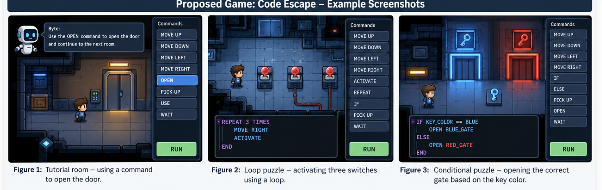
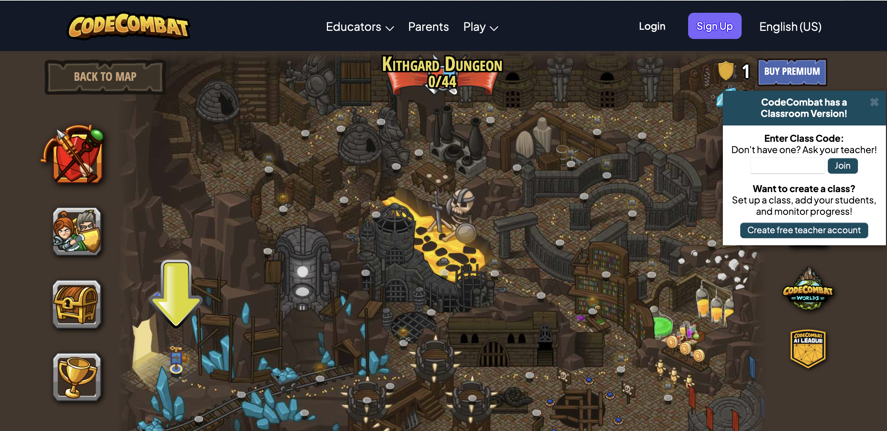
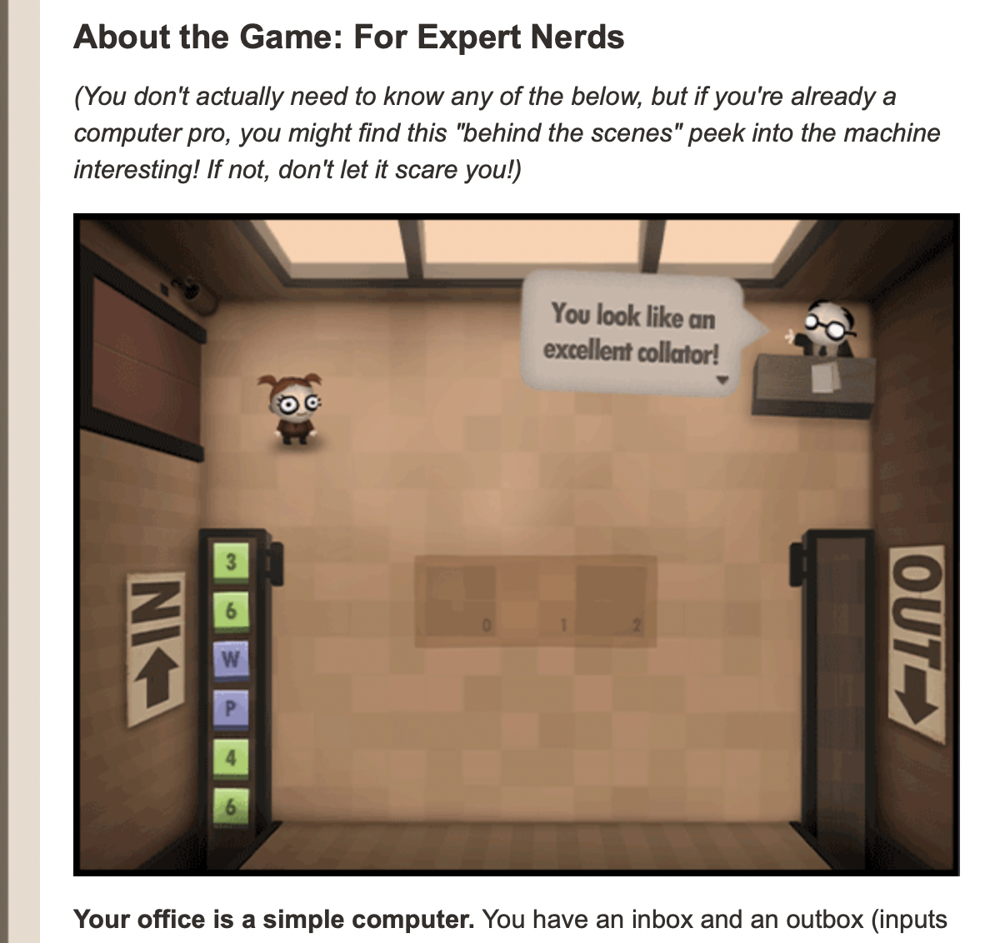
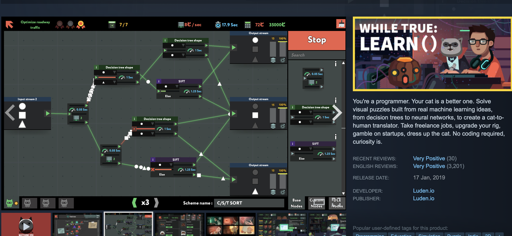

# Code Escape — Escape the Digital World

**Tagline: Solve puzzles, write code, and break free!**

## Game Concept


Code Escape is a 2D puzzle-adventure game in which the player is trapped inside a digital computer system taken over by a mysterious virus. To escape, the player progresses through rooms, solves puzzles using programming commands, and activates different mechanisms. As the game progresses, players learn variables, conditions, and loops through gameplay rather than traditional lessons. The ultimate objective is to reach the control room, disable the virus, and unlock the exit.

**Platform:** Personal computers and web browsers, controlled using a keyboard and mouse.


---

## Formal Elements

### 1. Players

The game is intended primarily for ages 12–18, especially students and beginners interested in programming and logical thinking. No previous programming experience is required.

It is a single-player game, with no direct competition or cooperation between human players. Instead, the player faces the game's puzzles and systems. More experienced players can aim for higher scores by solving puzzles with fewer hints.

### 2. Objectives

The main objective is to escape the computer system by completing five rooms and disabling the virus.

Each room has a specific objective, such as:

- Unlocking a door using the correct command.
- Activating three switches in the required order.
- Crossing a corridor containing moving robots.
- Repairing an electrical system using conditions and loops.
- Disabling the virus in the final control room.

At the beginning of each room, an on-screen message explains the objective. An exit icon shows where to go, and a progress bar displays the number of completed rooms.

### 3. Procedures

**Starting procedure — the first 30 seconds**

The player begins in a dark room with a locked door. A message appears: “The system has been hacked! Find a way out.”

A helper character named Byte introduces the first task: reach and activate the door. The player moves using the arrow keys or WASD. Approaching the door opens a command panel with an `OPEN` button. Clicking it unlocks the door, plays an animation, and awards 10 points. This immediate success teaches the basic interaction and encourages the player to continue.

**Core gameplay loop**

In each room, the player:

1. Enters and examines the obstacles.
2. Reads the current objective.
3. Selects commands in the programming panel.
4. Clicks `RUN` to execute them.
5. Observes the results in the game world.
6. Adjusts the commands if the attempt fails.
7. Solves the puzzle and proceeds to the next room.

**Detailed example — the loop room**

In the third room, three switches must be activated in sequence. The player could activate them individually, but a loop is more efficient:

```text
REPEAT 3 TIMES
    MOVE RIGHT
    ACTIVATE
END
```

After the player clicks `RUN`, the robot moves one step to the right and activates a switch, repeating this sequence three times. If the player specifies only two repetitions, two switches activate but the door stays locked. A message says, “One switch has not been activated.” The player learns the meaning of repetition through immediate feedback.

**Detailed example — the conditions room**

A corridor has two gates. The first opens with a blue key, and the second with a red key. The player creates the following condition:

```text
IF KEY_COLOR == BLUE
    OPEN BLUE_GATE
ELSE
    OPEN RED_GATE
END
```

An incorrect condition leaves the gate locked and triggers a hint about the failed check.

**Ending procedure**

In the fifth room, the player reaches the central server and combines concepts from earlier rooms to activate three security mechanisms, disable the virus, and unlock the exit. A victory animation then displays the final score, number of attempts, and hints used.

**Learning the procedures**

An interactive tutorial, highlighted buttons, short examples, and contextual hints introduce the mechanics gradually. Each room introduces one new mechanism before combining it with earlier ones.

### 4. Rules

- Players can move only through open areas of the map.
- A door unlocks only after its associated puzzle is solved.
- Players can select only the commands available in the current room.
- Clicking `RUN` executes commands in the order written.
- Invalid commands or attempts to move through walls stop execution and show an error.
- Each room begins with three available hints.
- Using hints does not block progress, but reduces the possible score.
- Players can retry puzzles as many times as they wish.

The first room's tutorial, error messages, and visual cues teach these rules.

### 5. Resources

**Points:** Each completed room awards a base of 100 points, minus 10 points for each hint used. A room's score cannot fall below zero. The introductory interaction awards 10 points as an immediate tutorial reward; the final room score follows the standard scoring rule.

**Hints:** Each room begins with three hints. Each reveals part of a solution rather than the entire answer. Unused hints do not carry over to later rooms.

**Commands:** New commands become available as the player progresses. For example, the first room provides movement and activation commands, while the third introduces `REPEAT`.

**Digital keys:** Collectible items used to open particular gates.

Resources remain limited through fixed hint allowances, gradual command unlocks, and keys placed behind puzzles. The top of the screen displays points, remaining hints, and collected items.

### 6. Conflicts

**Player versus system:** Locked doors, obstacles, robots, programming puzzles, and restrictions on available commands.

**Player versus other players:** None, because this is a single-player game.

**Player versus self:** The player must choose between spending a hint to solve a puzzle more easily and preserving points by solving it independently. Another choice is whether to use a long sequence of simple commands or find a shorter, more elegant solution.

### 7. Boundaries

The game world is closed, flat, and two-dimensional, consisting of five rooms connected by corridors. The player cannot leave the map. Walls, locked gates, and darkened areas communicate its limits.

**Meaning:** Each room represents a different programming concept, connecting the environment to the learning objective.

**Mobility:** Players move freely through accessible areas using the keyboard. Solving a room's puzzle allows access to the next room.

**Orientation:** A small map appears in the corner of the screen, marking the current room in blue and the exit in green.

**Interest:** Each room features distinct visuals, obstacles, animations, and a new gameplay mechanism.

**Guidance:** Lighting, arrows, and floor markings direct players toward important locations without revealing puzzle solutions.

### 8. Outcomes

Each room has three possible outcomes:

1. **Full success:** The puzzle is solved without hints.
2. **Assisted success:** The puzzle is solved using one or more hints.
3. **Unsuccessful attempt:** The player remains in the room and can try again.

The overall game is won by completing all five rooms and disabling the virus. Outcomes depend almost entirely on logical reasoning, problem-solving skill, and the player's decisions rather than chance.

This is not a zero-sum game: there is no human opponent whose loss is required for the player to win. The player instead overcomes challenges provided by the system.

---

## Review of Existing Games

**Suggested search phrases:**

- `programming puzzle games`
- `coding games for beginners`
- `educational escape room programming game`
- `CodeCombat programming game`
- `Human Resource Machine puzzle game`
- `while True learn programming puzzle`

These are suggested search terms for your market review; only list them as searches you performed after checking them yourself.

### 1. CodeCombat

**Official website:** https://codecombat.com/


CodeCombat is an educational adventure game in which players write real code to control a character, progress through levels, and overcome challenges.

**Similarity:** Both games combine programming, level progression, and interactive objectives in a game world.

**How Code Escape would differ:** Rather than emphasizing free-form code writing, Code Escape would use short escape-room puzzles, visual commands, and a continuous story about escaping a computer system. This could appeal to players who want to practice logical thinking before writing real code.

**Screenshot:** Insert a screenshot from the official CodeCombat website here.

### 2. Human Resource Machine

**Official website:** https://tomorrowcorporation.com/humanresourcemachine



Human Resource Machine is a puzzle game in which players program an office worker to perform tasks through sequences of instructions.

**Similarity:** Both games emphasize ordered commands, algorithmic thinking, and problem-solving.

**How Code Escape would differ:** Instead of office tasks, the player explores a digital world containing rooms, doors, robots, and keys. Programming commands directly affect the environment and advance the story.

**Screenshot:** Insert a screenshot from the official Human Resource Machine page here.

### 3. while True: learn()

**Store page:** https://store.steampowered.com/app/619150/



while True: learn() is a puzzle game built around machine-learning and artificial-intelligence concepts. Players solve problems by arranging visual components and diagrams.

**Similarity:** Both games use interactive puzzles to illustrate computing concepts.

**How Code Escape would differ:** Code Escape would focus on introductory programming concepts such as conditions, loops, and variables, presented through escape-room challenges with a character moving through a map.

**Screenshot:** Insert a screenshot from the game's Steam store page here.

### Formal Elements That Make Code Escape Distinctive

**Procedures:** Movement through a 2D environment is combined with programming commands that immediately change the game world.

**Objectives:** Each puzzle contributes to a clearly defined escape mission rather than existing as an isolated programming exercise.

**Conflicts:** The player faces a hostile computer system and makes decisions about whether to use hints or solve challenges independently.

**Boundaries:** Five rooms create a gradual learning path, with each area representing a different programming concept.

The proposed advantage is a short, accessible, story-driven escape experience that integrates programming concepts into puzzle-solving.

---


